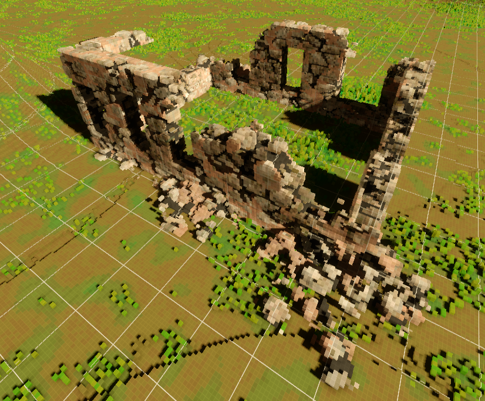
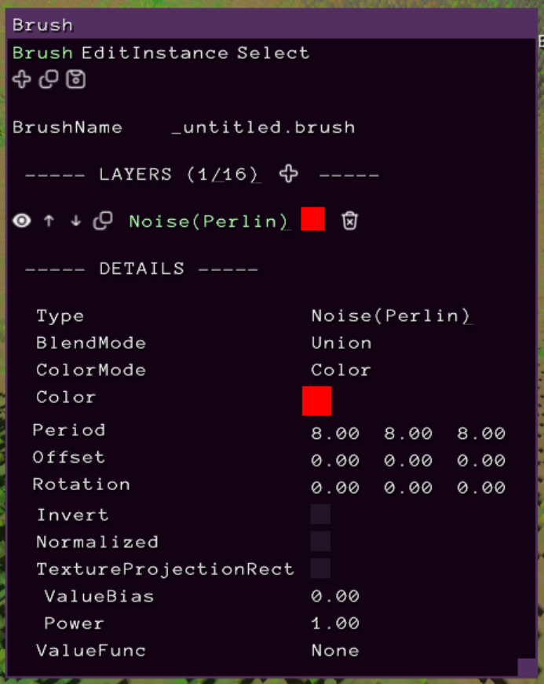

# Editor

To enter world edit mode, select "World Edit" from the menu in the top-left corner
of the screen.

## Overview

The editor comes with four tools, which can be toggled between using the "Tools" menu window.

* **[Brush](#brush-tool)**: Create and modify world edits using brushes.
* **[Stamp](#stamp-tool)**: Place copies of selected edits in the world.
* **[Prefab](#prefab-tool)**: Select a saved prefab and place an instance in the world.
* **[Entity](#entity-tool)**: Select an asset and place an entity using it.

## Brush Tool

Brushes are the backbone of the world editing system.  Brushes describe how a
world edit affects the selected area.

Edits are applied after terrain generation, and before meshing. See
[Terrain Generation & Editing](terrain_gen.md) for details on how to affect the
base terrain that is generated.

The Brush tool uses selection areas to define where world edits apply. Each
area is a box associated with a brush. Click an existing edit to select it, or
hold Ctrl while clicking to select multiple edits.  Multiple edits can be
modified simultaneously by modifying their aggregate selection bounds.

To create a new selection, select the Brush tool, press the NewSelection hotkey
(default Ctrl+S) and click two points in the world to define its bounds. The
new edit uses the currently selected brush.

To modify a selection, hold a modifier key, then click and drag a face of the
selection box. Keep the modifier held until you release the mouse button.

The DeleteEdits hotkey (default Delete) removes all selected edits.

See [Hotkeys and Controls](controls.md) and [`hotkeys.init`](../hotkeys.init)
for the full list of keybinds and details on customization.

 

### Brush Creation

To create a brush, select "New" (+ icon) in the "Brush" window.

### Brush Window

The brush settings describe a brush and its layers.  A layer produces a value
and color.  Layers are applied in order, from first to last.  A layers blend-mode
controls how that layer blends with the results of previous layers.  The brush
blend mode controls how the finished brush blends with the world.

#### Brush properties

* **BrushName**: The brush's name, used for its file in `brushes/`.
<!-- * **Modifier**: A stored brush-level modifier. It is not exposed in the brush -->
<!--   settings window or applied by the current GPU world-edit path. -->
<!-- * **Smoothing** (`ValueBlend`, `ColorBlend`): Stored value and color smoothing -->
<!--   settings. The current GPU world-edit path does not use either setting. -->
* **Layers / LayerCount**: The ordered layers. Use the icon controls to add,
  hide, reorder, duplicate, or delete layers.

#### Layer properties

Select a layer to edit by clicking on it in the LAYERS section.

* **Type**: Noise or Shape SDF

* **BlendMode**: How this layers final value and color blend with the preceding
  layers. See [Blend modes](#blend-modes).

* **ColorMode**: Choose **Color** or **Texture**.  Select a **Color** or **Texture**
  using the following controls.

* **Color**: A solid color used for shading the brush output.  Colors are selected
  using a 6-5-5 HSV palette (6 bits Hue, 5 bits Saturation, 5 bits Value (brightness))

* **Texture**: The texture asset used by texture color modes, selected from
  `assets/terrain_textures`.

* **TextureScale**: Scales texture sampling coordinates; larger values repeat
  the texture more frequently.

 

#### Noise settings

The noise subtype and its settings are selected through the layer's **Type**:

Not all noise types support all parameters.  The current release does not do a
good job at hiding parameters that are unsupported for a given noise type.

* **Perlin**: Gradient noise

* **Voronoi**: Cellular noise, also known as Worley noise

* **White**: White noise.

* **VoronoiLattice**: Cellular lattice.  Very slow, use sparingly

* **RectLattice**: Cellular, rectalinear

* **Period** controls its scale on each axis.

* **Squareness/Jitter** controls the cell-point distribution for cellular noises.

* **ChannelMask** Useful for masking out channels for noise generation.  Set to
  0 to mask a channel out.  Any other value scales the noise.  For example, if
  you wish to generate 2D noise instead of 3D noise, you can set any one
  channel to 0.

<!-- **MaskChance** is stored for Voronoi settings but is not used by the current -->
<!-- GPU brush path. The noise layer also contains a hidden, unused **Power** field; -->
<!-- use the common layer **Power** instead. -->

#### Shape settings

The shape subtype and its settings are selected through the layer's **Type**:

* **Rect**: **Dim** sets the dimensions. A nonpositive component is relative
  to the corresponding edit dimension; zero fills that dimension.

* **Sphere**: **Radius** sets the radius. A nonpositive value is relative to
  half the smallest edit dimension; zero fits that dimension.

* **Line**: **Radius** sets the thickness of the rounded line through the edit.

* **Cylinder**: **Radius** and **Height** set its size. Nonpositive values
  use the edit dimensions as a reference.

<!-- * **Plane**: **Orientation** selects its direction and **Thickness** sets the -->
<!--   width of the plane. -->

* **Torus**: **MajorRadius** sets the ring radius and **MinorRadius** sets the
  tube radius. Nonpositive values use the edit dimensions as a reference.

* **Pyramid**: **Height** sets the pyramid's height parameter.

Shape **Advanced** settings:

* **Hollow**: Creates a shell around supported shapes when positive. The line
  and plane paths currently do not apply it.

* **Rounding**: Adds to the shape's sampled value, expanding the resulting
  surface.

* **Stretch**: Elongates the shape along each axis.

* **Repeat**: Repeats the shape at the specified spacing on each axis. When
  enabled, use nonzero spacing on every axis.

<!-- The hidden shape **Type**, sphere **Location**, line **P0** and **P1**, and -->
<!-- advanced **__Rotation** fields are internal; use the type picker and common -->
<!-- layer rotation instead. -->

#### Layer transforms and values

These settings follow the noise or shape settings in the layer details.

* **Offset**: Shifts the coordinates used to sample the layer's SDF

* **Rotation**: Rotates the layer's sampling coordinates in degrees

* **Flags**:
  * **Invert** negates the layer value after Power and ValueBias.
  * **Normalized** uses edit-relative normalized coordinates for supported
    shapes, including rectangles, spheres, and cylinders.
  <!-- * **Disabled** hides the layer from the edit; the eye control toggles it. -->
  * **TextureProjectionRect** selects box-style texture projection instead of
    the default spherical-style projection.

* **ValueBias**: Adds a constant to the layer value after Power

* **Power**: Multiplies the sampled value when nonzero; zero leaves it
  unchanged. This is a multiplier, not an exponent.

* **ValueFunc**: Optional modifiers applied after Power, ValueBias, and Invert:
  * **ClampPos** clamps negative values to zero.
  * **ClampNeg** clamps positive values to zero.

  <!-- * **Threshold** zeros the value when the absolute sample before ValueBias -->
  <!--   and Invert is below the threshold. The current GPU path does not set a -->
  <!--   threshold value, so this modifier has no effect there. -->
  <!-- * **Discard** sets the layer value to zero. -->

<!-- * **Smoothing** (`ValueBlend`, `ColorBlend`): Stored per-layer smoothing -->
<!--   settings; neither is used by the current GPU world-edit path. -->

<!-- * **BasisOffset**: An internal, hidden field. The current GPU path uses -->
<!--   **Offset** for its sampling offset instead. -->

#### Blend modes

These modes apply to both layers and the finished brush. For layers,
`previous` is the accumulated result of earlier layers and `sample` is the
current layer value. For the brush, they are the world value and the combined
brush value respectively.

* **Union**: Takes the larger of `previous` and `sample`.
* **Intersection**: Takes the smaller of the two values.
* **Difference**: Negates `previous` where both values are positive.
* **SmoothUnion**: Smoothly combines the values using a fixed smoothing amount.
  It is currently hidden from the picker.
* **SmoothIntersection** and **SmoothDifference**: Hidden from the picker; they
  currently leave the value unchanged in the GPU path.
* **Additive**: Adds `sample` to `previous` when `sample` is positive.
* **Subtractive**: Subtracts `sample` from `previous` when `sample` is positive.
* **Multiply**: Multiplies the two values.
* **Disabled**: Leaves the accumulated value unchanged; it is hidden from the
  picker.

## Stamp Tool

The Stamp tool copies selected world edits to another location:

1. Select **Stamp** in the Tools window.
2. Use the Layers window to select one or more completed edits.
3. Click a terrain surface to place copies next to it. Click again to make
   additional copies.

The copies keep their relative positions, brushes, and per-edit settings, and
are added to the same layers as their source edits. The original edits remain
selected.

Press the JumpToStamp chord (default Ctrl+C) to switch to the Stamp tool.

### Stamp Basis

The stamp tool's Tools window has a Stamp Basis control. Its three values are
clamped to 0-1 across the combined bounds of the selected edits. The default
`(0, 0, 0)` places their minimum corner at the clicked point; `(0.5, 0.5, 0)`
centers them horizontally with their bottom at the clicked point.

## Prefab Tool

Prefabs let you save a layer of world edits and place it again:

1. In the Layers window, use a layer's **Export as Prefab** action. This exports
   all edits in the layer to `prefabs/<layer name>.prefab`.
2. Select **Prefab** in the Tools window and choose a prefab from **All Prefabs**.
3. Click a terrain surface to place an instance next to it. Each placement
   creates a new layer containing the prefab's edits.

The **Prefab** window shows the selected prefab's settings, including its
spawn callback, and provides a save action. Exporting a layer with the same
name as an existing prefab replaces that prefab.

## Entity Tool

Select **Entity** in the Tools window, then choose an asset in the **Assets**
window's **AssetFiles** view. Click a terrain surface to create an entity using
that asset next to the surface.
