# Welcome to Bonsai!

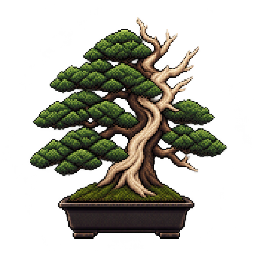

Bonsai is a long-running passion project.  It's been tended to with love and
care over the years, and is slowly becoming the tool I want to use to make games.

Bonsai supports very large worlds.  Worlds are capped at a maximum size of ~1
billion blocks, cubed.  At one block per meter, that's the distance from earth
to the moon 2600 times, in every direction.  The view distance is the entire
world, all the time.  In Bonsai, you can see in a straight line from Jupiter to
the sun.

Bonsai terrain generation is fully procedural, and user configurable.  Terrain
is generated on the GPU using regular glsl shaders.  Anything you can do in a
shader, you can do in a Bonsai terrain generator.

 

# AI Disclosure

For ten years and tens of thousands of hours spent programming on this project,
the primary goal has always been learning, and refining the skill of programming.
That has not changed with the recent advent of AI tooling.  I've been
experimenting with AI on this project since Aug 2026, and feel like it's a net
win when used deliberately and with intention.  Features that have accompaning
documentation in [docs](docs) are considered stable and any code that was
written, debugged, or assisted with AI in any way has been vetted,
line-by-line, by a human.

I care deeply about the quality of this project, and feel AI is a useful new
tool to add to the repitoire.

### 2.0.0-alpha Note

The engine has recently undergone a large rewrite of many core systems,
including the world generator and editor.  This rewrite is still in the process
of being finalized and releases will be marked with `alpha` until core systems
are completely ported and considered stable.

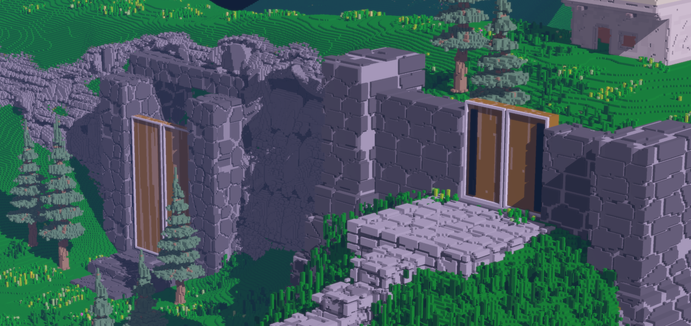

# Getting Started

Bonsai, and nearly all it's dependencies, are written completely from scratch.
External dependencies include the C runtime library for program startup, an
OpenGL-4.6 compatible graphics driver, and a handful of system-level libraries.

Building Bonsai requires clang++, a Bash-compatible shell, and platform-specific
system headers and libraries. See the [build guide](docs/01_build_process.md)
for notes on dependencies and build instructions.

## Quickstart

Grab pre-built binaries and assets for Windows or Linux from the
[Releases](https://github.com/scallyw4g/bonsai/releases) page.

### [Getting Started](docs/00_getting_started.md)

### [Build From Source](docs/01_build_process.md)

### [Controls](docs/controls.md)

### [Discord Server](https://discord.gg/kmRpgXBh75)

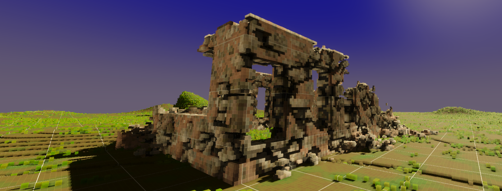

# Reviews from Random Denizens of the Internet

:star: :star: :star: :star: :star: like, dude. straight up magic. this is like, hundreds of millions of blocks, and it runs great.

:star: :star: :star: :star: :star: Oh that's lowkey fucking genius actually

:star: :star: :star: :star: :star: This person totally nailed it. Bravo

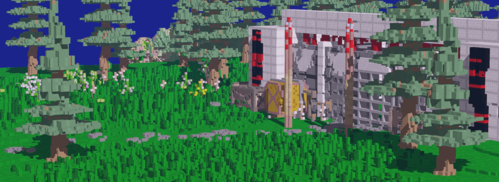

# Feature Sets

## Renderer

* Deferred Shading
* Order-independent Transparency (OIT)
* HDR Lighting
* Lighting Bloom
* Procedural skybox
* Cascaded Shadow Maps (CSM)
* Ground-truth ambient occlusion (GTAO)

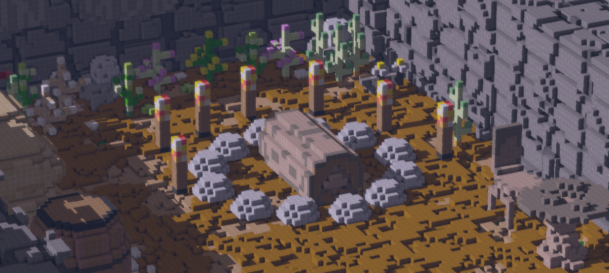

## Engine

* Hot Shader & Game-code Reloading
* Async Job System
* Entities
* Collision
* Transparent & Emissive Particles
* UI Framework
* Asset Loaders
* Primitive Physics

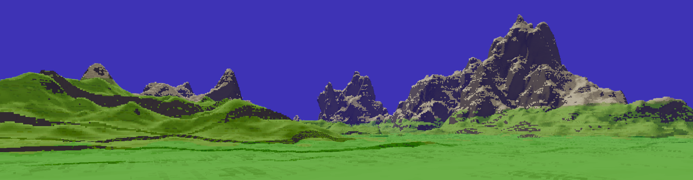

## Terrain Generation

* Fully programmable GPU-based terrain generation
* Batteries-included library of pre-built terrain shaders
* 1D, 2D and 3D noise library
* Terrain derivatives available in second-stage terrain "decoration"

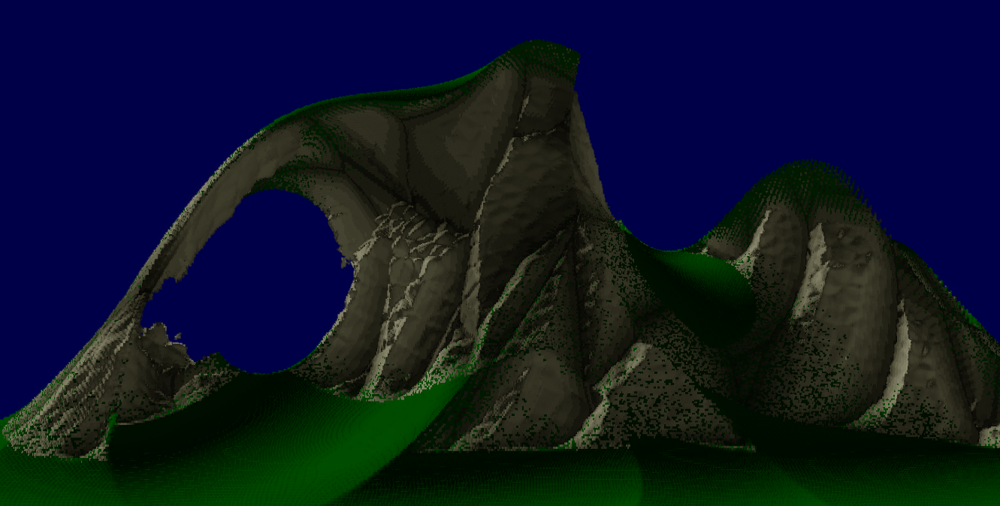

## Editing

* CSG-like SDF world editing
* Library of primitive shapes (rect, sphere, line, cylinder .. etc)
* SDF brush-based texturing of primitives

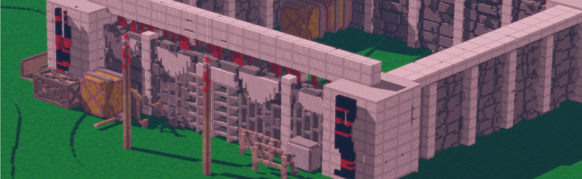

## SDF Brushes

* Layer-based brush GUI
* (coming soon) glsl brush shaders

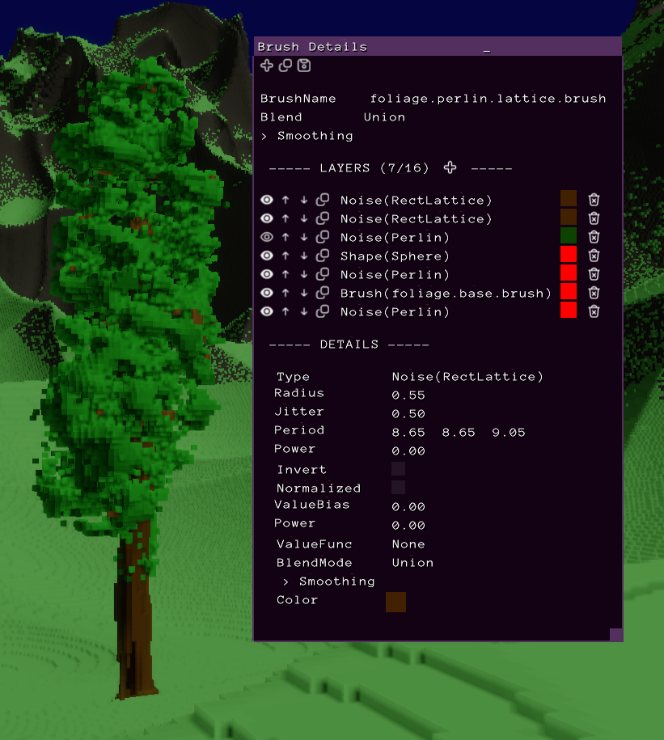

## Performance Profiler

* Manual Instrumentation
* Memory allocation tracking
* Multithreaded callgraph tracing
* Context Switches (windows only)
* Physical Core  (windows only)

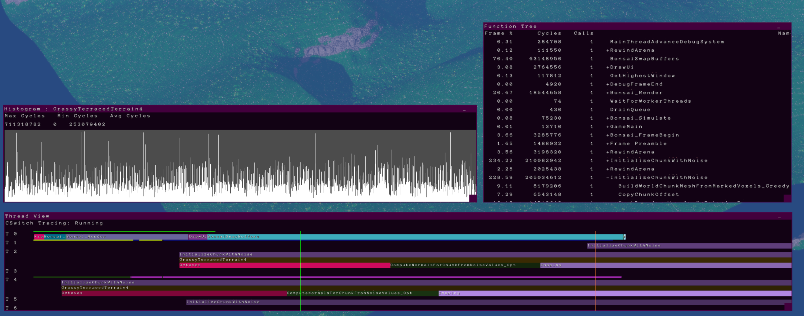

# Gallery

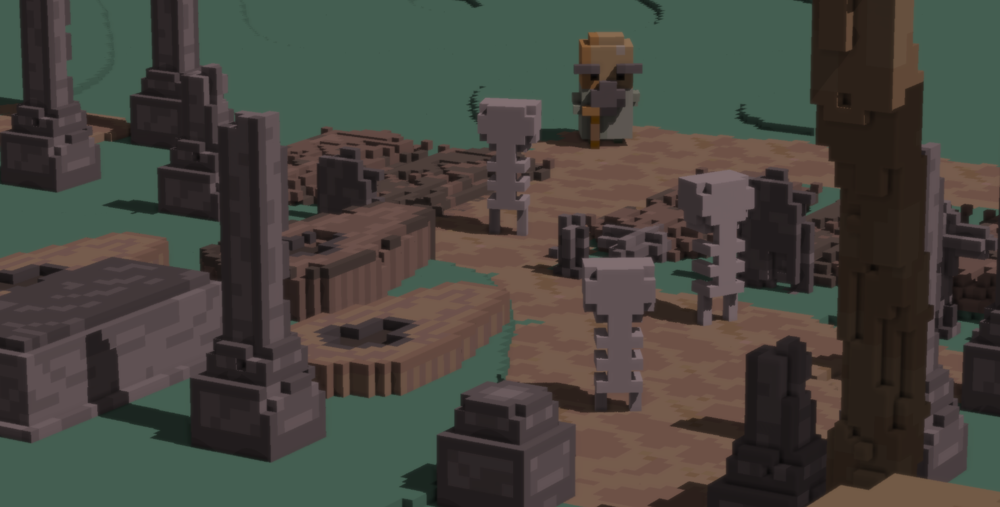

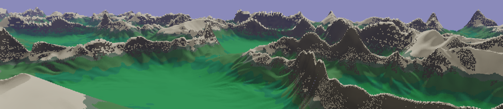

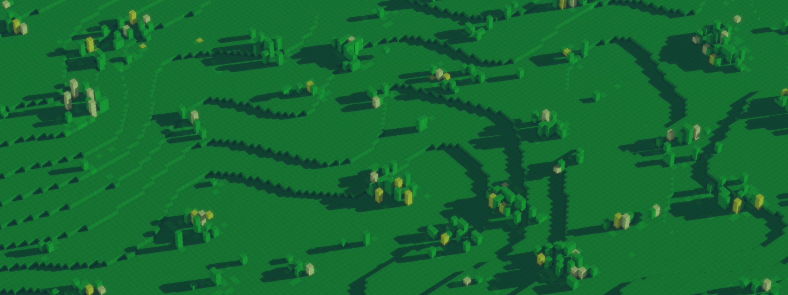

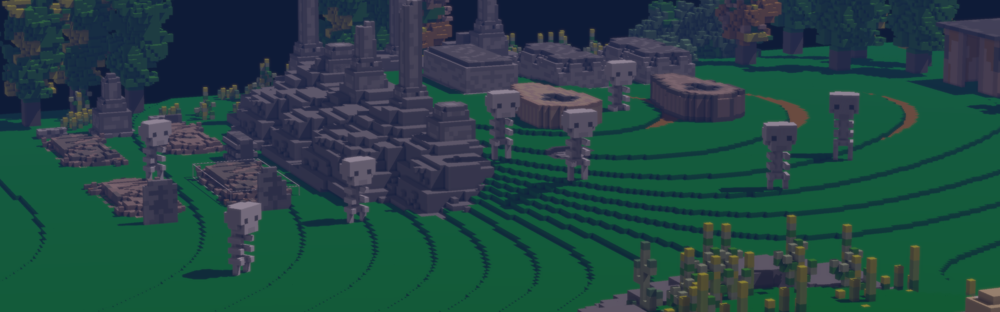

# Wishlist

-------------------------------------------------------------------------------
## Renderer

[ ] HRC : https://github.com/entropylost/amitabha

[ ] SSR : https://lettier.github.io/3d-game-shaders-for-beginners/screen-space-reflection.html

[ ] Screen-space lines : https://mattdesl.svbtle.com/drawing-lines-is-hard

[ ] Better shadows : https://developer.nvidia.com/gpugems/gpugems3/part-ii-light-and-shadows/chapter-8-summed-area-variance-shadow-maps

[ ] Screen Space Shadows : https://panoskarabelas.com/posts/screen_space_shadows/

[ ] Motion Blur : https://developer.nvidia.com/gpugems/gpugems3/part-iv-image-effects/chapter-27-motion-blur-post-processing-effect

[ ] TAA?

[ ] FXAA : http://blog.simonrodriguez.fr/articles/2016/07/implementing_fxaa.html

[ ] Water : https://www.youtube.com/watch?v=5yhDb9dzJ58

[ ] Fluids : https://andrewkchan.dev/posts/fire.html

[ ] Remove meshing entirely? https://www.youtube.com/watch?v=4xs66m1Of4A

[ ] Lumen-style GI screen-space radiance caching : https://www.youtube.com/watch?v=2GYXuM10riw

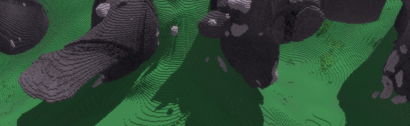

-------------------------------------------------------------------------------
## Terrain

[ ] Erosion simulation
* https://inria.hal.science/hal-01262376/document
* https://xing-mei.github.io/files/erosion.pdf
* https://nickmcd.me/2020/04/15/procedural-hydrology/

[ ] Biomes
* https://en.wikipedia.org/wiki/Holdridge_life_zones

[ ] Meshing
* Isotropic surface meshing
* https://graphics.stanford.edu/courses/cs164-10-spring/Handouts/isotropic.pdf
* https://inria.hal.science/inria-00071612/document

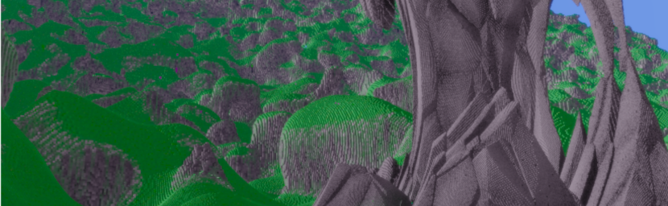

-------------------------------------------------------------------------------
## Assets

[ ] MCA importer
* https://github.com/GabeRundlett/gvox/blob/old/src/formats/minecraft.cpp

[ ] Sound : mp3, ogg, ..? decompressor

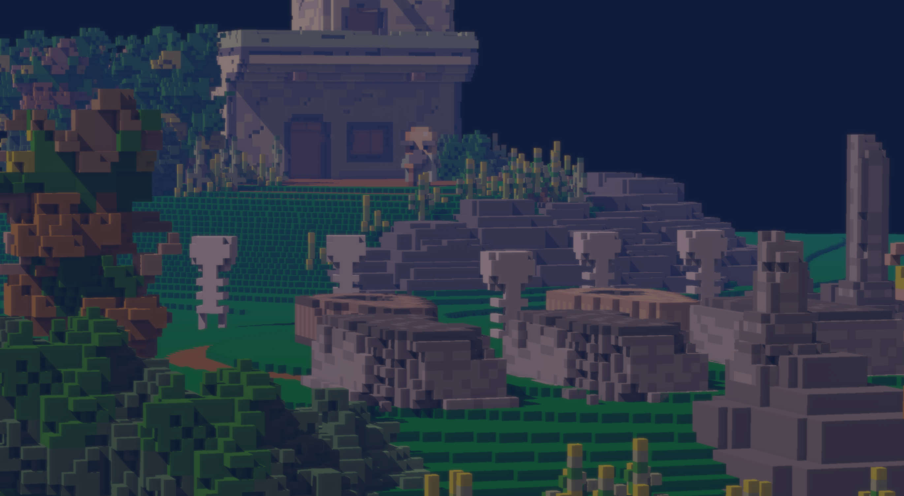

-------------------------------------------------------------------------------
## Datastructures

[ ] Better low-discrepancy sequences : https://blog.demofox.org/2017/05/29/when-random-numbers-are-too-random-low-discrepancy-sequences/

[ ] Better disk/sphere sampling patterns : https://extremelearning.com.au/how-to-generate-uniformly-random-points-on-n-spheres-and-n-balls/

[ ] Better hash function! : https://nullprogram.com/blog/2018/07/31/

[ ] Better GPU hashing! : https://arugl.medium.com/hash-noise-in-gpu-shaders-210188ac3a3e

[ ] Hash-trie as alternative to a table : https://nullprogram.com/blog/2023/09/30/

[ ] Octree ? https://graphics.tudelft.nl/Publications-new/2020/CBE20/ModifyingCompressedVoxels-main.pdf

[ ] Better floating-point rng : https://www.corsix.org/content/higher-quality-random-floats

[ ] Better greedy meshing? https://www.youtube.com/watch?v=4xs66m1Of4A

[ ] More interpolation goodies : https://paulbourke.net/miscellaneous/interpolation/

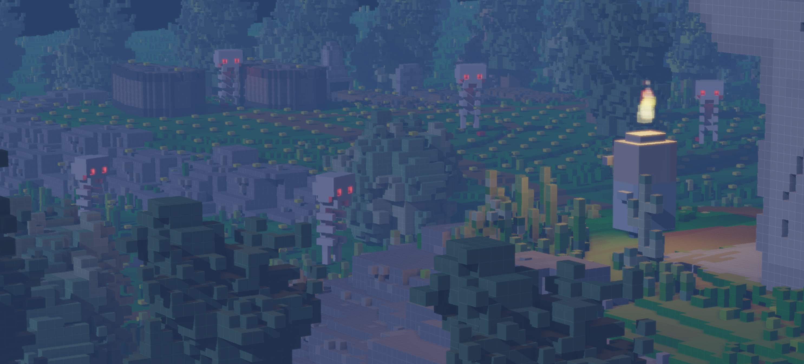

## Goodies

[ ] Better (faster) Sin/Cos ? https://www.shadertoy.com/view/432yWW

[ ] Look into using this Intel tooling for dual CPU/GPU world-gen?
    https://www.intel.com/content/dam/develop/external/us/en/documents/spir-vtointe-ispcgpu-compute-on-the-cpu.pdf
    https://ispc.github.io/

-------------------------------------------------------------------------------
## Profiler

[ ] Improve the ETW layer : https://github.com/bombomby/optick/blob/master/src/optick_core.win.h

[ ] GPU Profiling : https://www.khronos.org/opengl/wiki/Query_Object

